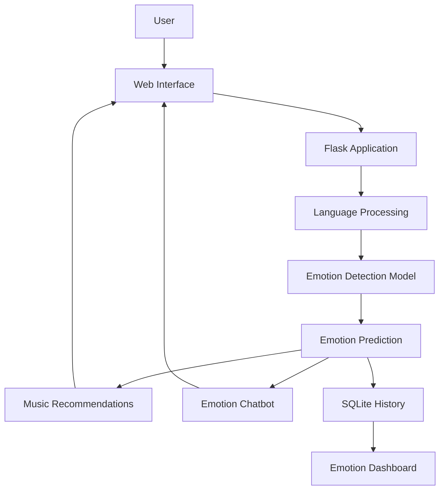

# 🎵 AI Music Emotion Assistant

An AI-powered web application that analyzes emotions from text and helps users discover music that matches their mood.

## ✨ Features

- **Emotion Detection:** Predicts emotions from text using a Transformer-based NLP model.
- **Multilingual Input:** Supports the project's text translation workflow before emotion analysis.
- **Music Recommendations:** Suggests music based on the detected emotion.
- **Emotion Chatbot:** Provides a conversational experience related to the user's mood.
- **Emotion History:** Stores emotion analysis history using SQLite.
- **Dashboard:** Visualizes emotion-related information through the web interface.

## 🛠️ Technology Stack

- **Language:** Python
- **Web Framework:** Flask
- **Machine Learning / NLP:** Hugging Face Transformers, PyTorch
- **Database:** SQLite
- **Frontend:** HTML, CSS, JavaScript, Chart.js
- **Model Serving:** Gunicorn
- **Containerization:** Docker

## 🧠 How It Works

1. The user enters text through the web interface.
2. The application processes the input and translates it when required by the multilingual workflow.
3. The emotion detection model predicts the emotion expressed in the text.
4. The application uses the result to provide relevant music recommendations and chatbot functionality.
5. Emotion history is stored in SQLite and can be presented in the dashboard.

## 🏗️ Architecture



## 📁 Project Structure

```text
ai-music-emotion-assistant/
├── app.py
├── model.py
├── recommender.py
├── chatbot.py
├── translator.py
├── database.py
├── templates/
│   └── index.html
├── static/
│   ├── style.css
│   └── charts.js
├── requirements.txt
├── Dockerfile
├── .dockerignore
├── .env.example
├── Screenshot.png
└── README.md
```

The directory layout above is illustrative. Keep only files and folders that actually exist in your repository, and adjust the frontend paths if your project uses a different structure.

## 🚀 Run Locally

### Prerequisites

- Python compatible with the project's dependencies
- Git
- Internet access for downloading model files when they are not cached

### Installation

1. Clone the repository:

   ```bash
   git clone https://github.com/Milan-maker-ui/AI-Music-Emotion-Assistant-.git
   cd AI-Music-Emotion-Assistant-
   ```

2. Create and activate a virtual environment.

   **Windows PowerShell:**

   ```powershell
   py -m venv .venv
   .\.venv\Scripts\Activate.ps1
   ```

3. Install dependencies:

   ```powershell
   python -m pip install -r requirements.txt
   ```

4. Start the application using the command supported by `app.py`:

   ```powershell
   python app.py
   ```

5. Open the local URL displayed by Flask in the terminal.

## 🐳 Run with Docker

Docker packages the application and its Python dependencies into an image, making the runtime environment more consistent.

### Prerequisites

- Docker Desktop installed and running
- Docker configured to use Linux containers

### 1. Build the image

Run these commands from the project directory containing the `Dockerfile`:

```powershell
docker build -t ai-music-emotion-assistant .
```

### 2. Start the container

```powershell
docker run --name ai-music-emotion-assistant-container -p 8000:8000 ai-music-emotion-assistant
```

### 3. Open the application

Visit:

http://localhost:8000

### 4. View application logs

In another PowerShell window:

```powershell
docker logs --tail 50 ai-music-emotion-assistant-container
```

### 5. Stop and remove the container

Press `Ctrl+C` in the terminal running the container. If it still exists, remove it with:

```powershell
docker rm -f ai-music-emotion-assistant-container
```

To rebuild the image after changing the application or Dockerfile:

```powershell
docker build --no-cache -t ai-music-emotion-assistant .
```

Remove the previous container before creating a new one with the same name.

## 🤗 Model Download

The application uses a Transformer model hosted on Hugging Face. Model files may need to be downloaded during the first startup, so initial loading can take longer than subsequent runs.

Unauthenticated Hugging Face access may display a warning about request limits. An access token is only necessary if your use case requires authenticated access or higher rate limits. Never commit private tokens or credentials to GitHub.

## 🔒 Security and Configuration

- Keep secrets and API keys in environment variables rather than hard-coding them.
- Do not commit `.env` files or private credentials.
- Review `.dockerignore` to exclude local virtual environments, Git metadata, caches, and secret files from the Docker build context.
- Do not expose development databases or sensitive user data in a public repository.

## 🧪 Testing

Before publishing changes, verify:

- The application starts successfully.
- The home page loads in a browser.
- Emotion detection returns a result for valid text.
- Music recommendations work for supported emotion results.
- The chatbot and translation workflow work as intended.
- Emotion history and dashboard functionality work, if enabled.

Add automated tests as the project evolves.

## 🗺️ Future Improvements

Potential improvements include:

- Automated unit and integration tests
- More robust error handling and input validation
- Improved Docker image size and startup performance
- CI/CD automation
- Cloud deployment and monitoring

## 👨‍💻 Author

**Milan Arote**

- GitHub: [Milan-maker-ui](https://github.com/Milan-maker-ui)
- LinkedIn: [Milan Arote](https://www.linkedin.com/in/milan-arote-0652872a5/)

---

*Built as an AI/NLP project exploring emotion detection, personalized music discovery, and interactive user experiences.*
