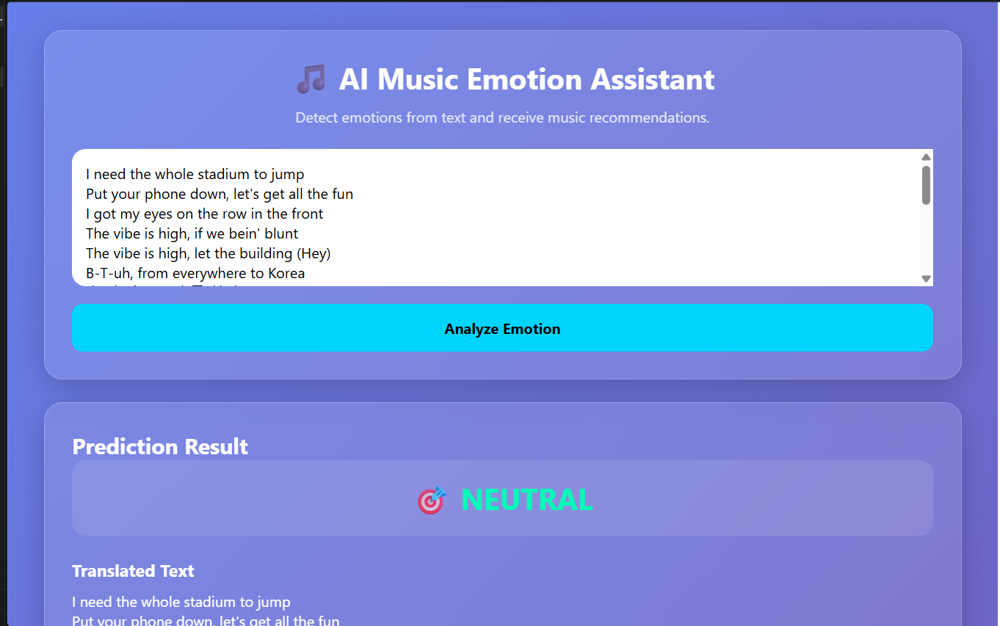

# 🎵 AI Music Emotion Assistant

An AI-powered web application that detects emotions from user text, supports multilingual input, recommends music based on detected emotions, and provides emotion-aware chatbot responses.

Built with **Python, Hugging Face Transformers, PyTorch, NLP, Flask, SQLite, HTML, CSS, and JavaScript**.

---

## 🚀 Features

### 🧠 Emotion Detection
- Uses **Hugging Face Transformers**
- Powered by the `j-hartmann/emotion-english-distilroberta-base` model
- Detects 7 emotions:
  - 😊 Joy
  - 😢 Sadness
  - 😠 Anger
  - 😨 Fear
  - 😲 Surprise
  - 😐 Neutral
  - 🤢 Disgust

### 🌍 Multilingual Input
Supports multilingual user input, including:
- English
- Hindi
- Marathi
- Other languages supported by Google Translate

User text is translated into English before emotion prediction.

### 🎵 Emotion-Based Music Recommendation

The application recommends music categories according to the detected emotion.

| Emotion | Recommendation |
|---|---|
| 😊 Joy | Happy Songs |
| 😢 Sadness | Motivational Songs |
| 😠 Anger | Relaxing Music |
| 😨 Fear | Calm Instrumentals |
| 😐 Neutral | Lo-Fi Music |

### 🤖 Emotion-Aware Chatbot

Generates supportive responses based on the detected emotional state.

### 📊 Visualization Dashboard

- Emotion confidence scores
- Interactive pie chart
- Responsive interface
- Loading indicators
- Emotion analysis results

### 💾 Analysis History

Prediction history is stored locally using **SQLite**, including:

- Original text
- Translated text
- Detected emotion
- Timestamp

---

## 🏗️ System Workflow

```text
                 User Input
                     │
                     ▼
          Multilingual Text Input
                     │
                     ▼
             Language Translation
                     │
                     ▼
          Hugging Face Transformer
                     │
                     ▼
             Emotion Detection
                     │
          ┌──────────┼──────────┐
          ▼          ▼          ▼
      Emotion     Music       Chatbot
      Result   Recommendation  Response
          │          │          │
          └──────────┼──────────┘
                     ▼
             Visualization UI
                     │
                     ▼
              SQLite History
```

---

## 🛠️ Tech Stack

### Backend & AI
- Python
- Flask
- Hugging Face Transformers
- PyTorch
- NLP
- Google Translate

### Data & Storage
- SQLite
- Python SQLite3

### Frontend
- HTML5
- CSS3
- JavaScript
- Chart.js

### Development
- Git
- GitHub

---

## 📂 Project Structure

```text
AI-Music-Emotion-Assistant/
│
├── app.py
├── model.py
├── recommender.py
├── chatbot.py
├── translator.py
├── database.py
│
├── index.html
├── style.css
├── charts.js
│
├── requirements.txt
├── Screenshot.png
├── emotion_history.db
│
└── README.md
```

---

## ⚙️ Installation

### 1. Clone the repository

```bash
git clone https://github.com/Milan-maker-ui/AI-Music-Emotion-Assistant-.git
cd AI-Music-Emotion-Assistant-
```

### 2. Create a virtual environment

```bash
python -m venv venv
```

### 3. Activate the environment

**Windows:**

```bash
venv\Scripts\activate
```

**macOS/Linux:**

```bash
source venv/bin/activate
```

### 4. Install dependencies

```bash
pip install -r requirements.txt
```

---

## ▶️ Run the Application

Start the Flask application:

```bash
python app.py
```

The application will run at:

```text
http://127.0.0.1:5000
```

Open the URL in your browser.

> The emotion classification model is downloaded automatically during the first execution, so an internet connection is required initially.

---

## 🧪 Example

### Input

```text
I am very happy because I completed my project successfully.
```

### Detected Emotion

```text
JOY 😊
```

### Music Recommendation

```text
Happy
Can't Stop The Feeling
Good Life
```

### Assistant Response

```text
You seem happy today. Keep enjoying the positive moments.
```

---

## 🗄️ Database

The application automatically creates an SQLite database:

```text
emotion_history.db
```

The analysis history contains:

```sql
CREATE TABLE analyses (
    id INTEGER PRIMARY KEY AUTOINCREMENT,
    original_text TEXT,
    translated_text TEXT,
    emotion TEXT,
    created_at TIMESTAMP
);
```

---

## 🧠 AI Model

The project uses:

```text
j-hartmann/emotion-english-distilroberta-base
```

### Frameworks

```text
Hugging Face Transformers
PyTorch
```

The model performs text-based emotion classification across seven emotion categories.

---

## 📸 Screenshots

### Application Interface



The interface provides emotion analysis, recommendations, chatbot responses, and visualizations in an interactive web interface.

---

## 🎨 UI Features

- Modern glassmorphism interface
- Responsive design
- Emotion visualization
- Confidence score display
- Interactive charts
- Loading animation
- Multilingual input

---

## 🔮 Future Improvements

- 🎙️ Voice-based emotion detection using Whisper
- 🎧 Spotify API integration for real-time music recommendations
- 🤖 Gemini/LLM integration for advanced emotional conversations
- 🔐 User authentication with Flask Login/JWT
- 🐳 Docker and Docker Compose deployment
- ☁️ Cloud deployment using AWS, Azure, Render, or Railway
- 📈 Advanced emotion analytics and user history

---

## 🎯 Learning Outcomes

This project demonstrates practical experience with:

- Machine Learning
- Natural Language Processing
- Transformer-based models
- Emotion classification
- Multilingual text processing
- Flask web development
- REST-style application architecture
- SQLite database integration
- Data visualization
- Frontend and backend integration

---

## 👨‍💻 Author

**Milan Arote**

**AI/ML Engineer | Machine Learning | NLP | Generative AI**

GitHub: [Milan-maker-ui](https://github.com/Milan-maker-ui)

LinkedIn: [Milan Arote](https://www.linkedin.com/in/milan-arote-0652872a5/)

---

## 📄 License

This project is developed for educational, learning, and portfolio purposes.
